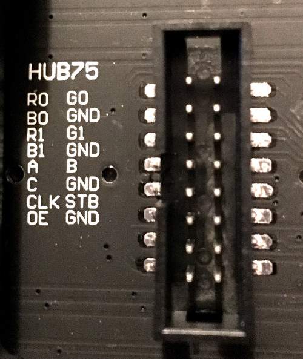

# Katxe's ProotOS
 
A library for driving protogens using a HUB75 style matrix using an ESP32
Based on [PanickingLynx's ProtOpenSource](https://github.com/PanickingLynx/ProtOpenSource) and powered by the [ESP32-HUB75-MatrixPanel-DMA](https://github.com/mrcodetastic/ESP32-HUB75-MatrixPanel-DMA) library.

- **Author:** Katxe (Telegram: `@Katxe` | Bluesky: `@katxe.bsky.social`)

## Features
- Microphone animations
- Boop sensor capabilities
- Different facial expression selection
- Animations are hand drawn frames from .png file, the library lets you convert them into protogen displays
- Super easy to set up custom animations and boop reactions

## Software Setup

You will need Python, PlatformIO and your IDE of choice to use this library (I recommend VSCode).

### Installing Pythons
- Python is required for converting .gif and .png files into raw code the program can read
- Go to [python.org/downloads](https://www.python.org/downloads/) and download the latest version of Python
- **IMPORTANT:** On the very first screen of the Python installer, **check the box at the bottom that says `"Add python.exe to PATH"`** before clicking **Install Now**.
- Once Python finishes installing, open the `lib/FacialSprites` folder inside this project and double-click **`install python dependencies.bat`** (for Windows users only, if on Mac or Linux, you will need to install the Pillow library manually. There should be plenty of tutorials available).
  - Wait until it says `Done!` and press any key to close it.

### Installing VSCode & PlatformIO (For Uploading to the ESP32)
- Download and install **[Visual Studio Code (VSCode)](https://code.visualstudio.com/)**.
- Open VSCode, click the **Extensions** icon on the left sidebar (the four squares), search for **`PlatformIO IDE`**, and click **Install**.
- Wait a few minutes for PlatformIO to finish installing (you will see a little alien icon appear on the left sidebar when it is ready).
- In VSCode, go to **File → Open Folder...** and select the project folder (the folder containing `platformio.ini`).

---

## Hardware Wiring Guide

### ESP32 to HUB75 LED Matrix Display

ProotOS is configured for **two 64×32 HUB75 LED matrix panels chained together** (forming a 128×32 display). Connect the **DATA IN** port of your first panel to your ESP32 using the pin mapping below (defined in `src/functions/drawfaces.h`):



(Image source: https://github.com/2dom/pxmatrix)

| HUB75 Panel Pin | ESP32 GPIO Pin | Description |
| :--- | :--- | :--- |
| **R1/(Also Called R0 on some boards)** | `GPIO 25` | Top half Red data |
| **G1/G0** | `GPIO 26` | Top half Green data |
| **B1/B0** | `GPIO 27` | Top half Blue data |
| **R2/R1** | `GPIO 14` | Bottom half Red data |
| **G2/G1** | `GPIO 12` | Bottom half Green data |
| **B2/B1** | `GPIO 13` | Bottom half Blue data |
| **A** | `GPIO 23` | Row address line A |
| **B** | `GPIO 19` | Row address line B |
| **C** | `GPIO 5` | Row address line C |
| **D** | `GPIO 17` | Row address line D |
| **E** | *Unused* | Only used on 64×64 (1/32 scan) panels. You can connect this to ground |
| **CLK** | `GPIO 16` | Clock signal |
| **LAT** | `GPIO 4` | Latch signal |
| **OE** | `GPIO 15` | Output Enable |
| **GND** | `GND` | Make sure atleast 1 GND pin is connected to the ESP32 |

If any pins are unspecified, then you can leave them either connected to GND or dangling.

> **Note:** Do **not** power the LED matrices directly from the ESP32's 5V pin. Power the HUB75 panels from a dedicated 5V power supply (e.g., a 5V buck converter or high-output power bank), and connect a **GND** wire between the panels/power supply and the ESP32's **GND** pin.

---

### Wiring the Microphone, Boop Sensor, and Face Button

The sensor pins are defined at the top of `src/main.cpp`:

| Component | ESP32 Pin | How to Wire It |
| :--- | :--- | :--- |
| **MAX4466 Microphone** (`MIC_PIN`) | `GPIO 35` | • **VCC** → ESP32 `3.3V`<br>• **GND** → ESP32 `GND`<br>• **OUT** → ESP32 `GPIO 35` |
| **Boop Sensor** (`BOOP_PIN`) | `GPIO 33` | • Connect your sensor's **3.3V or 5V** and **GND** to the ESP32.<br>• Connect the sensor's **Signal / OUT** pin (which goes HIGH / 3.3V when booped) to `GPIO 33`.<br> |
| **Face Selector Button** (`FACE_SELECTOR`) | `GPIO 32` | • Wire one leg of a push button to ESP32 **`3.3V or 5V`**.<br>• Wire the other leg of the button to ESP32 **`GPIO 32`**.

---

## Converting `.png` and `.gif` Files

Before the code can use an image or .gif file, it has to be converted into raw code. Two python scripts are provided for that, convgif.py and convimg.py for .gif and .png images respectively. 

All facial sprites and GIF animations live in the **`lib/FacialSprites/`** folder. Each sprite/GIF is drawn for **one side of the visor (64×32 pixels)** and is automatically mirrored to the second panel by the code (unless you turn mirroring off). The images must remain inside the directory to be included in the code when you run the python scripts. 

- **To add or update `.png` sprites (faces, mouths, static boop images):**
  - Place your `64×32` `.png` files directly into `lib/FacialSprites/`.
  - Double-click **`run convimg.bat`** (Windows only).
    - If you are on Mac/Linux, you will need to run the Python command manually:
    - python convimg.py
  - This automatically packs all `.png` files in that folder into `lib/FacialSprites/images.h`. The variable name in code will match the filename (for example, `happy.png` becomes `happy` in the code).
- **To add or update `.gif` animations (animated boop reactions):**
  - Place your `64×32` `.gif` files directly into `lib/FacialSprites/`.
  - Double-click **`run convgif.bat`** (Windows only).
   - If you are on Mac/Linux, you will need to run the Python command manually:
   - python convgif.py
  - This automatically packs all `.gif` files in that folder into `lib/FacialSprites/animations.h`. The variable name in code will match the filename (for example, `spiral.gif` becomes `spiral` in the code).

---

## Facial Expression Selector
All facial expressions are configured in **`src/user/faces.h`**

### Adding a New Face

Open **`src/user/faces.h`** in VSCode. Copy an existing face block and customize its settings:

```cpp
// Example: The normal, default face
const Face normalFace = {
  .idleSprite    = normal,      // Name of your idle .png file (normal.png)
  .blinkSprite   = blink,      // Name of your blink .png file (or set to nullptr to disable blinking)
  .blinkHoldTime = 100,        // How long (in ms) the blink stays closed
  .offsetX       = 0,          // Horizontal pixel shift (0 = centered)
  .offsetY       = 0,          // Vertical pixel shift (0 = centered)
  .overlay       = true,       // TODO, doesn't work currently, supposed to let you overlay on the prev frame
  .mirror        = true,       // Mirrors the 64x32 sprite onto the second panel
  .modifier      = abberation, // Visual effect: `abberation`, `crt`, or `nullptr` (none)
  .canTalk       = true,       // Set to true to animate mouth when speaking, or false for a silent face
  .faceDelay     = 100,        // Delay (in ms) between frame updates
  .talkThreshold = 300,        // Mic volume needed to trigger normal talking frames
  .loudThreshold = 600,        // Mic volume needed to trigger loud talking frames
  .yellThreshold = 1500,       // Mic volume needed to trigger yelling frames
  .talkPool      = { talk1, talk2, talk3, talk4, talk5 }, // Normal talking .png sprites
  .loudPool      = { loud1, loud2, loud3, loud4, loud5 }, // Loud talking .png sprites
  .yellPool      = { yell1, yell2, yell3, yell4, yell5 }  // Yelling .png sprites
};
```

> - If a face shouldn't move its mouth when you talk (like `smugFace`), simply set `.canTalk = false` and set `.talkPool = { nullptr }`, `.loudPool = { nullptr }`, and `.yellPool = { nullptr }`.
> - You don't have to use exactly 5 talking frames. You can put anywhere from 1 to 255 sprites inside `{ ... }`. The code automatically counts how many sprites you give it.

At the bottom of **`src/user/faces.h`**, add `&newFace` (with the `&` in front of the name) to the `faceSelector` list:

```cpp
const Face* faceSelector[MAX_FACES] = {
  &normalFace,
  &smugFace,
  &normalSilentFace,
  '&normalFace'         // <-- Added here
};
```
The code will automatically add it to your face pools, and pressing your Face Selector button will now cycle through your new face.

---

## Boop Animations

All boop reactions are configured in **`src/user/boops.h`**.

ProotOS uses a weighted pool system for boops: when someone boops your visor, it picks a random boop reaction from the pool, reduces its remaining uses, and won't repeat it until all other boop reactions in the pool have been displayed.

### Creating a Boop Reaction

Open **`src/user/boops.h`**. A `Boop` can be:
- **A GIF animation** (set `.animation = &yourGif` and `.staticSprite = nullptr`)
- **A static `.png` image held for a set time** (set `.animation = nullptr` and `.staticSprite = yourPng`)


If you define both a gif and a static animation, it will play both of them sequentially with the animation coming first.

```cpp
// Example A: Playing a GIF animation (from animations.h)
const Boop boopBk = {
  .animation    = &bk,     // Name of your .gif file with `&` in front
  .staticSprite = nullptr, // No static image after the GIF
  .holdTime     = 0,       // Ignored when staticSprite is nullptr
  .offsetX      = 0,
  .offsetY      = 0,
  .overlay      = true,    // TODO, doesn't work currently, supposed to let you overlay on the prev frame
  .mirror       = true,    // Mirror across both panels
  .modifier     = nullptr, // Effect for staticSprite (`abberation`, `crt`, or `nullptr`)
  .poolWeight   = 1        // How many times this boop can play per pool cycle before being removed
};

// Example B: Holding a static .png image (from images.h)
const Boop boopBsod = {
  .animation    = nullptr,    // No GIF animation
  .staticSprite = boopBsod,     // Name of your .png file (no `&` needed for static sprites)
  .holdTime     = 2500,       // Hold on screen for 2500 ms (2.5 seconds)
  .offsetX      = 0,
  .offsetY      = 0,
  .overlay      = false,
  .mirror       = true,
  .modifier     = nullptr, // Use nullptr to specify that no modifier is to be added
  .poolWeight   = 2           // Can be picked twice per cycle before being removed from the pool
};
```

At the bottom of **`src/user/boops.h`**, add your new boop (with `&` in front of its name) to `boopPool`:

```cpp
const Boop* boopPool[MAX_BOOP_ANIMATIONS] = {
  &boopBk,
  &boopBk1,
  &boopBk2,
  &boopAmogus,
  &boopBsod,
  '&boopBk', // <-- Added here
  '&boopBsod'   // <-- Added here
};
```

---

## Uploading the Code to Your ESP32

- Plug your ESP32 into your computer using a USB data cable.
- Open the project folder in **VSCode**.
- Look at the blue/bottom status bar at the very bottom of the VSCode window:
  - Click the **Checkmark (`✓`)** icon (**PlatformIO: Build**) to test-compile your code and make sure there are no compilation errors.
  - Click the **Right Arrow (`→`)** icon (**PlatformIO: Upload**) to flash the code onto your ESP32.
- If the upload gets stuck at `Connecting........_____`, hold down the **BOOT** button on your ESP32 board for 2 seconds until the upload percentage starts moving, then release it.
